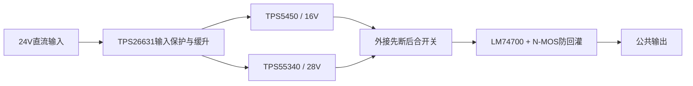

# 24V 输入、16V / 28V 双路电源课设

基于 TPS5450 降压、TPS55340 升压的电力电子课程设计。两路电源集成于一块100×100mm双层PCB，通过外接机械开关选择公共输出。

**当前状态：已完成仿真、原理图及PCB数字检查，裸PCB已下单；尚无焊接完成和实物性能测试结果。** 目标是选中一路输出2A，不代表两路能同时各输出2A。

## 结构

机械切换期间输出可能中断；28V降到16V时可能先保持较高电压再下降。输入保持通电不等于输出无缝切换。

## 文件入口

|内容|文件|
|---|---|
|嘉立创EDA专业版原理图及PCB|[RevC无图案工程](hardware/easyeda/BuckBoost_RevC_NoLogo.epro2)|
|裸板制板文件|[Gerber ZIP](hardware/gerber/Gerber_RevC_NoLogo.zip)|
|按原设计导出的BOM|[design_bom.csv](hardware/bom/design_bom.csv)|
|实际采购清单及替代值|[Excel](hardware/bom/purchasing_list.xlsx)、[CSV](hardware/bom/purchasing_list.csv)|
|淘宝检索词与尺寸要求|[采购指南](docs/purchasing-guide.md)|
|装配和上电步骤|[上电说明](docs/assembly-and-bringup.md)|
|装配替代与验证状态|[版本说明](docs/revision-notes.md)|
|MATLAB仿真复现|[仿真说明](simulation/README.md)|

## 主要器件

- Buck：TPS5450DDAR；Boost：TPS55340PWPR。
- 输入eFuse：TPS26631PWPR，设计标称约50ms缓升、3.52A限流，故障锁断。
- 选档后防回灌：LM74700QDBVRQ1 + STP55NF06L。
- 固定电阻和陶瓷电容使用1206；芯片底部散热焊盘需要可靠回流焊接。
- 电感22µH；优先按BOM完整型号或已经核对尺寸的替代型号采购。

## 已有证据及限制

RevC原生PCB DRC无错误；原理图检查致命错误0、错误0、警告0。导出核对有63个元件位置、185条引脚网络、422段走线、28个板级过孔及双面GND填充。

SPS等效模型已运行，代表参数假设下的开关功率级与等效反馈，不是TI芯片内部控制宏模型。合并模型从已建立的电压状态开始，不用于证明冷启动安全。原独立Boost硬输入冷启动诊断曾得到约41.84V开关节点尖峰；后续增加输入保护的整板尚未用同等模型或实物验证。

实物仍需验证：输入浪涌、SW尖峰、MLCC直流偏压有效容量、环路稳定性、纹波、负载瞬态和2A连续工作温升。输入没有反接保护。具体测试负载见上电说明。

## 使用

1. 嘉立创EDA专业版导入epro2，编辑器版本为3.2.175。Gerber与原设计值匹配。
2. 对照采购清单装配；当前装配采用R1=120kΩ、R13=220kΩ替代原118kΩ、230kΩ。电阻值变化不改变PCB，但会改变调节范围和保护阈值。
3. 先焊一块样机，限流空载上电，再逐级加负载。实测未完成前不把本项目当作已验证成品。

## 来源与许可

原厂资料使用链接引用，未随仓库分发老师任务书、学长报告或TI官方TINA参考文件。EDA工程含厂家元件库模型，其权利属于相应权利人。工程截图缩略图为原生导出的一部分。

项目作者尚未选择开源许可证，本整理版本没有擅自添加MIT等授权。发布前请由作者确认可公开的原创内容、学校要求及元件库再分发条件；公开仓库本身不等于授予任意复用许可。
