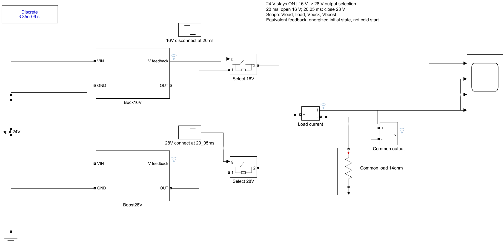
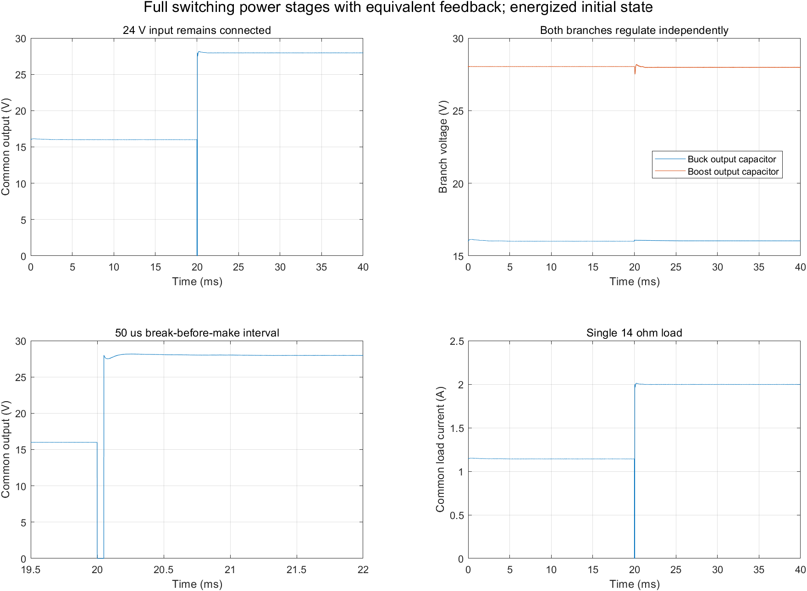

# 仿真模型与复现

原运行环境：MATLAB/Simulink R2021b、Simscape Electrical Specialized Power Systems。较新版本需要确认SPS库兼容性。仿真数据来自此前实际运行，本次整理未重新执行MATLAB仿真。

## 双路合并与选档

在MATLAB中将当前目录切换到 `simulation/merged`，执行：

```matlab
build_merged_converter;       % 从两个source.slx重建，确认无未保存编辑再执行
metrics = run_merged_converter;
validation = validate_merged_converter;
```

也可直接打开BuckBoost_16V_28V_merged.slx查看。脚本使用自身所在目录，无需修改个人绝对路径。运行后生成merged_data.mat；验证函数依赖该文件，因此先运行run函数。两份source.slx是重建依赖。

此前模型记录：14Ω公共负载，0.02s断开16V，0.02005s接入28V。公共输出稳态均值约15.9957V和27.9703V，选档空隙最低约0.000617V。**空隙输出近零，不能据此宣传无缝切换。** 该模型中的PI/PWM为等效反馈，不是TPS芯片宏模型，也未包含RevC输入eFuse整板。





## 独立升压

切换到 `simulation/boost28v`：

```matlab
build_boost28v_equiv;
run_boost28v_equiv;
validate_boost28v_equiv;
```

验证需要run函数生成的boost28v_main_data.mat；其他分析脚本见文件头部说明。Boost_28V_simple.slx是简洁展示版，位于boost28v_simple。

原MAT大文件、FIG、SLXC与slprj缓存未随仓库提交。CSV/JSON及结果图用于核对先前运行结果；重新运行可能因版本和数值环境而存在差别。冷启动失败诊断也保留，见boost28v_coldstart图及对应说明，不把失败诊断当成合格硬件结果。
