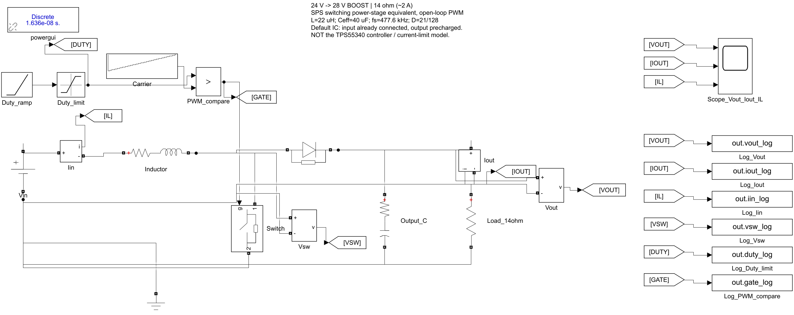
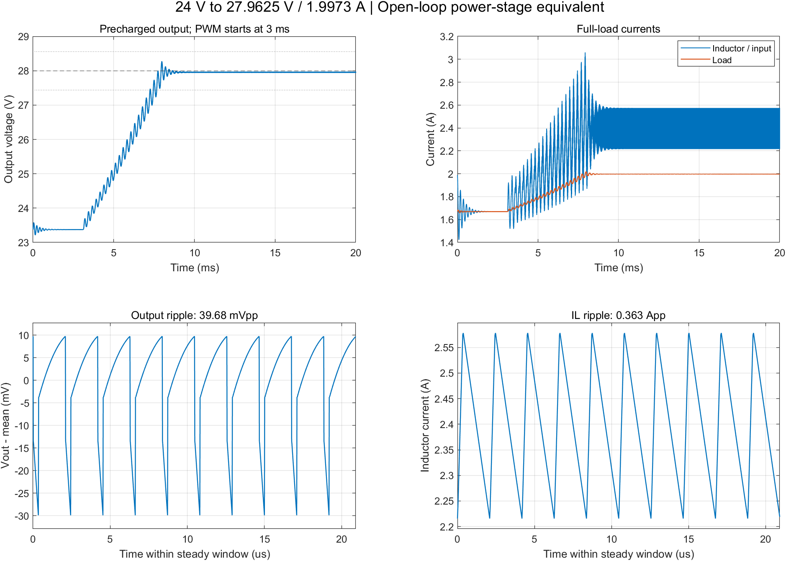
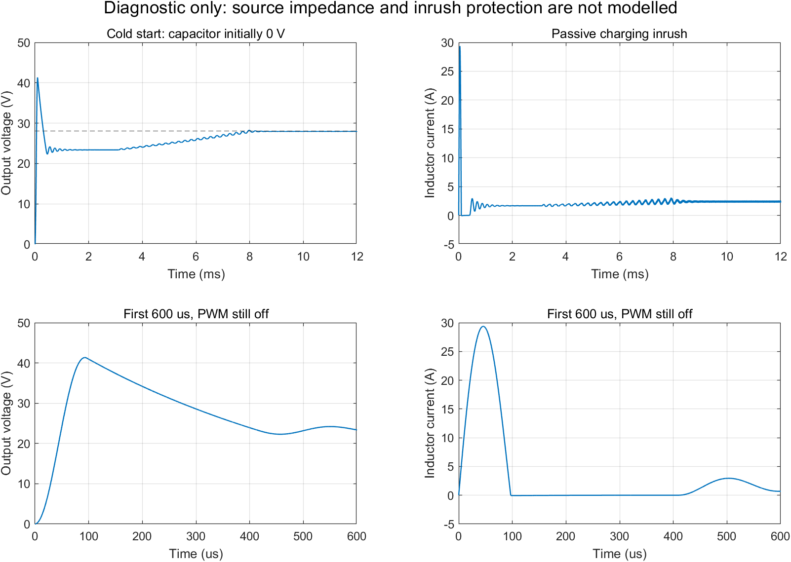

# 24V输入、28V输出的Boost功率级等效仿真

日期：2026-10-27。以下数值来自本次实际运行的Simulink SPS开关模型，不是参考报告结果或硬件实测。

## 1. 目的与模型层级

验证候选升压功率级在24V直流输入时能否在约2A负载下达到28V附近的输出，并测量开关纹波、启动过程和电感电流。

模型采用电感、理想开关加导通电阻、二极管加压降和导通电阻、带ESR的输出电容及电阻负载。采用独立PWM和占空比缓升，不含电压反馈闭环，不能代表TPS55340内部电流模式控制、外部补偿、限流或温度行为。

## 2. 原理及参数

开关闭合时，输入经电感及开关向地形成充磁通路，输出电容向负载供电；开关断开后，电感经二极管向输出电容及负载传递能量。二极管阳极接开关节点，阴极接输出正端；开关接在开关节点与地之间。

理想连续导通近似为：

`Vout = Vin/(1-D)`

理想24→28V的占空比约14.286%。本模型计入压降和导通损耗后，固定占空比取21/128，即16.40625%。这是当前负载与参数下的开环工作点，不是芯片自动稳压规律。

| 参数 | 值 | 来源或说明 |
|---|---:|---|
| 输入 | 24V | 任务指标，理想电压源 |
| 主负载 | 14Ω | 28V时约2A |
| 附加负载 | 13.9Ω | 验证略高于2A的工作点 |
| 电感 | 22μH | 前期设计候选值，线性电感 |
| 电感串联电阻 | 0.074Ω | 候选电感DCR上限近似，不随温度变化 |
| 输出电容 | 有效40μF | 前期陶瓷阵列的有效容量假设，未替代偏压曲线核查 |
| 输出电容ESR | 0.01Ω | 工程假设，须与最终器件、频率和布局核实 |
| 开关导通电阻 | 0.06Ω | TPS55340手册5V测试条件下典型值的近似，不是24V或高温保证值 |
| 二极管压降 | 0.5V | 工程假设，不随电流与温度变化 |
| 二极管导通电阻 | 0.001Ω | 工程假设 |
| 开关频率 | 477.6kHz | 与前期100kΩ设频的标称估算对齐 |
| 稳态占空比 | 16.40625% | 21/128，实测门极占空比一致 |
| 主步长 | 16.35783ns | 每开关周期128步，PWM采样与求解器一致 |
| 仿真时长 | 20ms | 3ms开始PWM，5ms占空比缓升，之后留稳态区间 |

默认初始电容电压约23.3748V、初始电感电流约1.6696A，对应输入已接通后的预充状态。设置初值仅定义此实验的起始工况，不证明已实现预充保护。

## 3. 实际结果

稳态统计窗口为末尾100个完整开关周期，未抽取，每步保存数据；波形图放大末尾10个周期。

| 指标 | 14Ω工况实际值 |
|---|---:|
| 平均输出电压 | 27.962511V |
| 平均输出电流 | 1.997322A |
| 平均电压误差 | −0.133889% |
| 电压纹波峰峰值 | 39.683306mV |
| 电感平均电流 | 2.398667A |
| 电感电流纹波峰峰值 | 0.362766A |
| 输出功率 | 55.850153W |
| 当前预充启动工况电压峰值 | 28.275489V |
| 当前预充启动工况电感峰值 | 3.063551A |
| 进入并保持28V±2%范围的时间 | 约7.666ms，从仿真起点计 |
| 仿真运行警告数 | 0 |

因输出略低于28V，14Ω下电流略低于2A。为避免将“约2A”直接当作“≥2A”证据，另将负载改为13.9Ω，得到：

- 平均输出电压：27.960748V。
- 平均输出电流：2.011565A。
- 电压纹波：40.121135mVpp。
- 在当前等效模型和该工作点下，电流超过2A，平均电压处于27.44～28.56V范围。

若任务书的“100MV”最终确认是100mVpp，则上述稳态模型的纹波低于此值；测量带宽、实际尖峰与实物结果仍待确认。

模型的部分导通损耗计算效率约97.02%。由于未计开关交叠、驱动、芯片静态功耗、电感磁芯损耗、二极管恢复与温升，此数值仅是该简化模型的能量比，不能作为TPS55340电路或整机的实际效率。

## 4. 时间步长检查

将步长减半至8.17892ns，同时将每周期载波点数增加到256，维持开关频率和占空比不变。检查采用预置稳态附近初值运行3ms，仍用末尾100周期统计。

| 指标 | 原步长 | 半步长 |
|---|---:|---:|
| 平均电压 | 27.962511V | 27.962499V |
| 纹波峰峰值 | 39.683306mV | 39.979229mV |

平均电压差约12μV，纹波差约0.746%。此检查说明当前主要稳态结果对所选时间步长不敏感，不证明未建模的寄生尖峰或真实器件行为。

## 5. 冷启动诊断：尚未通过的项目

另将电容电压、电感电流初值均设为0，在t=0施加理想24V阶跃。PWM仍在3ms前关闭，3～8ms缓慢增加占空比。

| 指标 | 当前简化模型结果 |
|---|---:|
| 输出电压峰值 | 41.336821V |
| 开关节点电压峰值 | 41.840141V |
| 电感电流峰值 | 29.369311A |

这些峰值发生在PWM投入之前：输入经电感与二极管直接给空电容充电，形成启动冲击及LC过冲，单纯缓升PWM无法阻断此路径。

TPS55340手册规定SW绝对最大电压为40V。本简化冷启动工况的开关节点峰值超过该额定，因此不能据稳态结果宣布硬件设计已通过。应在进一步设计中加入实际电源输出阻抗/上升过程、浪涌管理并验证启动电压。电感饱和也未建模，29A不应当成真实器件安全工作或准确峰值预测。

默认主工况与冷启动诊断一起保留，不能通过预置电容电压来掩盖冷启动问题。

## 6. 可用于实验报告的阶段结论

本次建立了24V输入、28V输出的非同步Boost开关功率级等效模型。采用22μH电感、有效40μF输出电容、477.6kHz开关频率及16.40625%固定占空比。在14Ω负载下，稳态平均输出为27.9625V、1.9973A，电压误差约−0.134%，输出纹波约39.68mVpp；在13.9Ω下输出电流达到2.0116A，电压仍处于28V±2%范围。时间步长减半后纹波差异不到1%。该结果支持所选功率级在目标工作点的原理可行性，但不能替代TPS55340内部控制、补偿、保护及实物热性能验证。零电压冷启动诊断暴露了被动充电冲击，仍需完善输入启动管理。16V/28V合并切换实验尚未包含在本模型中。

## 官方参考

- [TI TPS55340数据手册](https://www.ti.com/lit/ds/symlink/tps55340.pdf)：第4页SW绝对最大额定；第5页导通电阻；第9～11页内部控制与软启动。PWM占空比缓升不等同于其实际软启动限流过程。
